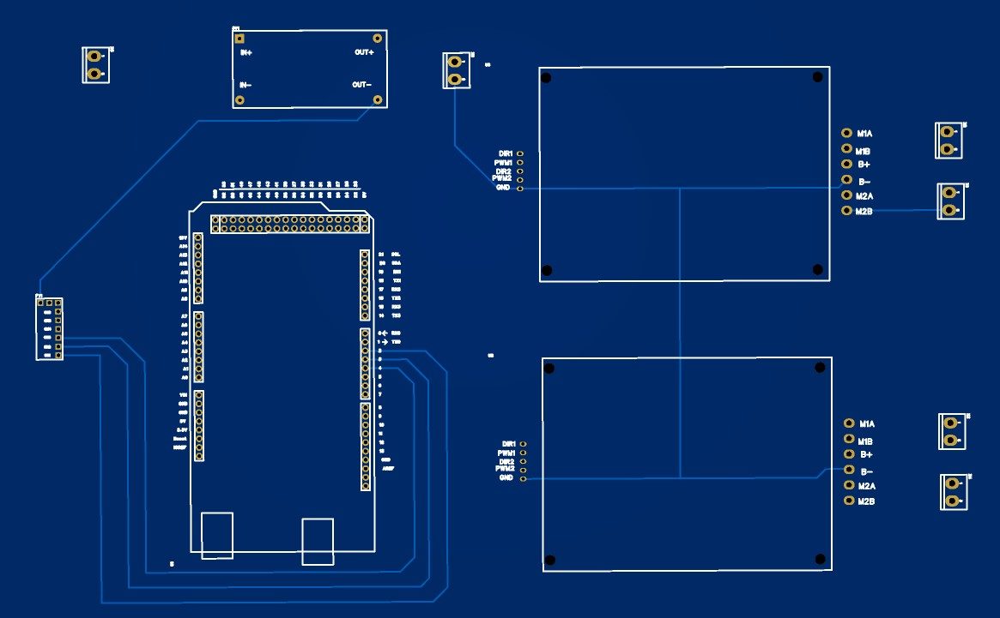

# Battle Bot – Flipper

A radio-controlled battle robot with four-wheel differential steering, a 24 V drive system, and a reversible automotive wiper motor for the flipper. This repository contains the control sketch, electronics images, parts list, and testing notes.

## How it works

The RC receiver provides steering, throttle, and flipper commands. The controller combines throttle and steering to drive the left and right sides independently. A separate output controls the flipper in both directions.

The included sketch provides a command deadband, stops motor outputs when an RC pulse is missing or out of range, and waits 1.5 seconds at startup. It does not include neutral-start checking, acceleration limiting, flipper limit-switch handling, or a maximum flipper run time.

## Repository materials

| Material | Location |
| --- | --- |
| Arduino control sketch | [BattleBotFlipper.ino](firmware/BattleBotFlipper.ino) |
| Parts list | [Bill of materials](hardware/BOM.md) |
| Circuit schematic | [Schematic image](hardware/Sch-BB.jpg) |
| PCB layout | [PCB image](hardware/PCB-BB.jpg) |
| Board preview | [3D board view](hardware/3D-BB.jpg) |
| System overview | [Block diagram](hardware/system-block-diagram.svg) |
| Controller layout concept | [PCB concept](hardware/pcb-concept.svg) |
| Testing precautions | [Safety notes](docs/SAFETY.md) |

## Hardware preview

[View the schematic](hardware/Sch-BB.jpg) · [View the PCB layout](hardware/PCB-BB.jpg)

The schematic and board images show an **Arduino Mega 2560** and two dual-channel motor drivers. The sketch and SVG concept diagrams identify an **Arduino Uno**. Their pin assignments are not a verified match to the pictured circuit; confirm the controller and wiring before using the sketch. Editable PCB files are not included.

## Firmware pin assignments

| Function | Pins in the sketch |
| --- | --- |
| RC steering / throttle / flipper | 2 / 4 / 7 |
| Left motor PWM / direction | 5 / 8 |
| Right motor PWM / direction | 6 / 9 |
| Flipper PWM / direction | 10 / 12 |

Driver ratings, wiring, and fuses depend on motor stall current and battery voltage. Read the [testing notes](docs/SAFETY.md) before powering the robot.
